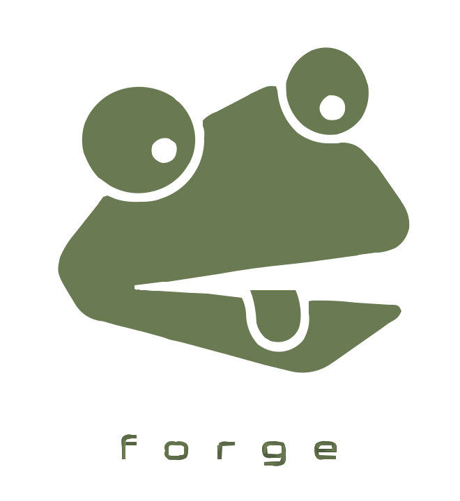

<p align="center">
  <picture>
    
  </picture>
</p>

# forge

[](https://www.npmjs.com/package/@lzear/forge)
[](https://jsr.io/@lzear/forge)
[](https://github.com/lzear/forge/commits/main)
[](https://app.codacy.com/gh/lzear/forge)
[](https://app.codacy.com/gh/lzear/forge)
[](LICENSE)
[](https://github.com/lzear/forge)

> Shared dev tooling, configs, and standards for all lzear repos.

## Packages

- **[`@lzear/forge`](packages/forge)** — umbrella: one dep for everything + `forge` CLI
- **[`@lzear/configs`](packages/configs)** — tsconfig, vitest, tsdown, vite, commitlint configs
- **[`@lzear/eslint-config`](packages/eslint-config)** — ESLint flat config (npm only, [inspector](https://lzear.github.io/forge/))
- **[`@lzear/repo-lint`](packages/repo-lint)** — repo compliance checker

## Adopt

```sh
yarn add -D @lzear/forge   # or bun add -D
yarn forge init            # --app, --bun|--yarn, --dry
```

`forge init` writes what is missing, never overwriting: `package.json` scripts, `packageManager` (the newest past the age gate), `type`, `engines` and, for a library, the fields npm and tsdown need (lorem ipsum `description` and `keywords` to replace), `tsconfig.json`, ESLint, Vitest and commitlint configs extending forge's ([configs](packages/configs), [ESLint config](packages/eslint-config)), `renovate.json`, `.github/workflows/main.yml` calling [CI](#ci) (and release, for a Yarn library) pinned to the release, `.gitignore`, LICENSE and a badged README (libraries), the release-age gate, `forge sync`'s files and, without `src/`, a `src/index.ts` and its test (and Vite's `index.html` when `react` is a dependency, which also picks the React tsconfig and the jsdom Vitest config). It prints the steps left (the dev deps at forge's ranges, npm's trusted publisher, optional Codacy), ending with `forge check --skip-remote` ([checks](packages/repo-lint#checks); `--fix` repairs some), which it runs itself once the dev deps are installed.

`lefthook.yml` runs `eslint --fix` on staged files, gitleaks on staged changes (skipped when not installed) and commitlint, under any package manager.

Complements [e18e](https://e18e.dev): the ESLint config runs `e18e/ban-dependencies`.

## CI

Call the reusable workflow, SHA-pinned (renovate bumps it). It runs the `build`, `typecheck`, `lint` and `test` scripts (tests with coverage), uploads coverage to Codacy when `CODACY_PROJECT_TOKEN` is set (optional: add the repo on app.codacy.com, then `gh secret set CODACY_PROJECT_TOKEN`) and audits workflows with zizmor. gitleaks gates in CI, on the pushed or PR commit range, and at pre-commit. A `bun.lock` switches it to Bun.

```yaml
on:
  push:
    branches: [main]
  pull_request: # one run per PR push

jobs:
  ci:
    uses: lzear/forge/.github/workflows/ci.yml@<sha> # v5.0.0
    secrets:
      CODACY_PROJECT_TOKEN: ${{ secrets.CODACY_PROJECT_TOKEN }}
    # with:
    #   node-version: '26'
    #   coverage-command: yarn test --coverage
  release:
    if: github.event_name == 'push'
    needs: ci
    uses: lzear/forge/.github/workflows/release.yml@<sha> # v5.0.0
    permissions:
      contents: write
      pull-requests: write
      id-token: write
    # with:
    #   node-version: '26'
    #   version-script: yarn changeset version
    #   jsr: false # also deno publish
```

Release needs `@lzear/configs` as a dev dep and the npm trusted publisher set to `<owner>/<repo>` / `main.yml`.

Custom jobs: `uses: lzear/forge/actions/setup@<sha>` (node + corepack + cache + install; inputs `node-version`, `cache`, `install-command`).

Renovate: `"extends": ["github>lzear/forge"]` (digest-pinned actions, updates wait 3 days except own packages, patches automerged after 7). It opens no major update of a `package.json` range, nor a minor update of a `^0.x` range, because Renovate writes those as `^6.0.0` where the `lzear/major-version-only` rule asks for `^6`; an agent does them with `forge update`.

## Development

```sh
yarn qa          # build + typecheck + lint + test + forge check (drift warns)
yarn housekeep   # update deps, refresh snapshots, qa, then forge check --strict
yarn changeset   # then merge to main
```

`main` → "Version Packages" PR → merge → staged on npm (`npm stage approve`), published to JSR, GitHub release. Prereleases: `yarn changeset pre enter beta|rc`, `yarn changeset pre exit`. Alpha/beta without a release: `yarn lzear-prerelease beta --publish`.
